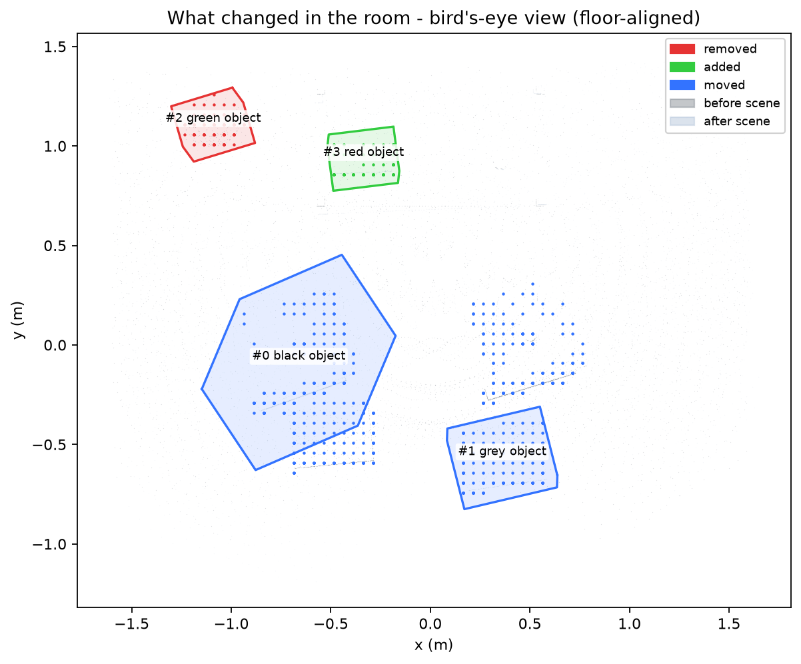

# What Changed in the Room?

I take two phone clips of the same small indoor space, one before and one after a few objects are moved, added
or removed. The pipeline reconstructs both clips into one shared 3D representation, aligns them to a common floor
frame, looks for changes in 3D (by voxel regions and by object), and labels what it finds.

```
before.mp4 ─► frames ─► MASt3R ─┐
                                ├─► align (floor prior + ICP) ─► voxel regions ─► OWLv2 labels ─► descriptions
after.mp4  ─► frames ─► MASt3R ─┘        │                                          └► bird's-eye map + 3D viewer
                                         └─► YOLO-World objects lifted to 3D ─► matched across clips ─► footprint check
```

Design choices and their trade-offs are in [DESIGN.md](DESIGN.md). The sources behind each technique, and what
each one leaves open, are in [research.md](research.md). The working rules for this repository are in
[agentbible.md](agentbible.md).

## Status on my own clips (read this first)

I ran the full pipeline on my own two clips and on a downloaded pair with independent ground truth (ObChange
Kitchen). It runs end to end (exit 0). Where it stands — DESIGN.md opens with one comparison table across all
three datasets (synthetic, my clips, the downloaded pair):

- The object detector finds **5 of the 8 known changes on the downloaded pair at precision 1.00 (recall
  0.62)**: the moved sugar box, the removed soup can and all three added objects, each confirmed at the right
  physical position under one rigid transform. The 3 misses (bowl, mug, skillet) sit at the extreme periphery
  of the captured sweep — the bowl's spot appears 1-6 pixels from the image border in only 4 of 60 frames, the
  mug's in 9 (the reconstruction resolves bare tabletop there), and the skillet's old spot is not reconstructed
  at all. The camera never really saw those three changes; no detector or rule can recover objects the frames
  do not contain. Measured to the bottom (`scripts/probe_periphery.py` plus GT-spot projection): at confidence
  0.10, on full frames and on 2x-upscaled border crops, no detection lifts to 3D at the bowl's and mug's old
  spots or the skillet's either spot. A second detector family agrees: OWLv2 finds bowls in those frames, but
  they are *other* bowls 1.7 m from the ground-truth spot — the missed objects themselves are never detected
  anywhere, at any confidence. Recovering them reliably needs a wider sweep at capture time.
- On my clips the pipeline now reports **one confirmed physical change**, and it earns it honestly. The object
  stage's `added bag` at (0.84, -0.34, 0.01) m is confirmed by cross-method agreement with the voxel stage's
  19.4 L added region: two methods that share only the geometry report one change at one spot, and the identity
  layer folds the region's candidates into that one record. Its own spot evidence is deliberately not enough —
  at this capture pair's ~0.21 m reconstruction noise the no-change control produces *the same* evidence for
  things that never moved (a `removed pillow` with 7 empty / 0 contrary / 2 unseen ring votes, against the
  bag's 6 / 0 / 3), so a noise gate demotes every spot-only verdict to candidate and only voxel agreement
  confirms. Ten other objects stay unconfirmed, each with its numbers in `objects.md`.
- The voxel detector finds 1 added region on the 60-frame pair of my clips and none on the downloaded pair (0
  of its 8 known changes). The reconstructions disagree by about as much as the changes (DESIGN.md, section 3).
- **0 false alarms everywhere**: both no-change controls re-run with the current code (mine and ObChange's) end
  with zero confirmed changes; an earlier no-false-alarm result on 3 parity controls still holds a fortiori (the
  current rules only demote more), and every demoted record keeps its reason.

What is still missing is the change list for the clips you provided; with it, `evaluate_changes.py` scores the
whole pipeline on them. The label question is measured meanwhile: on the object's own crops OWLv2 reads
`backpack` (0.51-0.61) or `bag` (0.25-0.48) in every frame that sees it — the region-level "black stool" label
(0.50, from a low-resolution crop) never wins the head-to-head. The interactive viewer for my clips is
`outputs/canonical/visualizations/viewer.html`; the example below comes from the synthetic scene.

## Example output

Bird's-eye view of a synthetic desk scene with 4 known changes (floor-aligned; generated by `visualize.py`):



Generated description text (no labeler, so object names are colours only; see DESIGN.md):

```
- moved   - The black object was moved about 1.2 m, to the left.
- moved   - The grey object was moved about 0.9 m, to the right.
- removed - A green object that was there before is no longer present.
- added   - A red object (about 35 cm long) was added.
```

The interactive 3D viewer (`outputs/visualizations/viewer.html`) is written by the pipeline and is not
committed, to keep the repo small.

## Installation

Requires Python 3.11 and an NVIDIA GPU for reasonable speed (tested on an RTX 5050 Laptop, 8 GB).

```bash
python -m venv .venv
source .venv/bin/activate          # Windows (Git Bash): source .venv/Scripts/activate
pip install torch torchvision --index-url https://download.pytorch.org/whl/cu128
pip install -r requirements.txt    # includes ultralytics (YOLO and YOLO-World) for the object stage
git clone --depth 1 https://github.com/naver/mast3r.git third_party/mast3r   # MASt3R/DUSt3R code
```

Model weights are downloaded on first use: MASt3R metric ViT-L and OWLv2 from Hugging Face. YOLOv8n and
YOLO-World (`yolov8s-worldv2.pt`) come from ultralytics into `models/` (git-ignored). YOLO-World also writes a CLIP
text model into `weights/` (git-ignored). With Conda, run `conda env create -f environment.yml` and then the same
`pip` steps for torch and MASt3R.

## Reproduce

Put the two clips in `data/before/before.mp4` and `data/after/after.mp4`, then:

```bash
python scripts/run_all.py                 # full pipeline
python scripts/run_all.py --no-labeler    # skip the OWLv2 labels
```

Each stage is also a standalone script in `scripts/`:

| Stage | Script | Output |
|---|---|---|
| 1. Frame extraction + quality filter | `extract_frames.py` | `data/*/frames/` + `manifest.json` |
| 2. Dense reconstruction (MASt3R) | `reconstruct.py` | `outputs/reconstructions/*.npz`, `*.ply` |
| 3. Alignment | `align.py` (`--color` adds colour ICP, off by default) | `after_aligned.npz`, `alignment/alignment.json` |
| 3b. No-change control | `make_control.py`, `reconstruct.py`, `align.py` | `control/` (noise floor for detection) |
| 4. Voxel change regions | `detect_changes.py` (`--null` = control) | `change_maps/changes.pkl`, `changes.json` |
| 4b. Object changes | `detect_objects.py --detector yolo-world` (real pair, then control) | `objects/objects.json`, `objects/objects.md`, `objects_null/objects.json` |
| 5. Labels + descriptions | `describe_changes.py` | `descriptions/changes.md`, `changes.json` |
| 6. Visualisation | `visualize.py` | `visualizations/bev.png`, `viewer.html` |
| 7. Graphs | `make_graphs.py` | `outputs/graphs/*.png` |
| 8. Label consistency on real crops | `check_labels.py` | `outputs/label_check/labels.json` |

### Second pair with ground truth (ObChange)

The pipeline is also run on a public dataset pair with object-level change annotations: the ObChange dataset
(TU Wien, CC BY 4.0, https://researchdata.tuwien.at/records/y3ggy-hxp10), Kitchen room, scene2 (before) vs
scene3 (after) — 8 real changes (3 added, 2 removed, 3 moved). The rosbags are large, so pull just the two
scenes out of `Kitchen.zip` through the archive's per-file endpoint and convert the HSR head RGB stream:

```bash
curl -L -o data/datasets/obchange/scene2.bag \
  "https://researchdata.tuwien.at/api/records/y3ggy-hxp10/files/Kitchen.zip/container/GH30_kitchen/scene2.bag"
curl -L -o data/datasets/obchange/scene3.bag \
  "https://researchdata.tuwien.at/api/records/y3ggy-hxp10/files/Kitchen.zip/container/GH30_kitchen/scene3.bag"
python scripts/obchange_to_frames.py data/datasets/obchange/scene2.bag data/datasets/obchange/videos/kitchen_scene2.mp4
python scripts/obchange_to_frames.py data/datasets/obchange/scene3.bag data/datasets/obchange/videos/kitchen_scene3.mp4
python scripts/run_all.py --before data/datasets/obchange/videos/kitchen_scene2.mp4 \
  --after data/datasets/obchange/videos/kitchen_scene3.mp4 \
  --out outputs/obchange_2v3 --frames-dir data/datasets/obchange/frames --max-frames 60
```

Ground truth comes from the dataset's per-scene object poses (scenes share one coordinate frame, so diffs of
the object lists are real changes): `obchange_gt.py` derives the change list, `score_obchange.py` scores a run
against it. The annotations are inside `ObChange.zip` (`<Room>/sceneN/planes/*/*.anno`).

```bash
python scripts/obchange_gt.py data/datasets/obchange/extracted/Kitchen/scene2 \
  data/datasets/obchange/extracted/Kitchen/scene3 --out data/datasets/obchange/gt_kitchen_2v3.json
python scripts/score_obchange.py outputs/obchange_2v3 data/datasets/obchange/gt_kitchen_2v3.json
```

Scoring is type level: the dataset frame and the pipeline's floor frame differ, so positions are not compared
until the two are registered. `data/datasets/` is git-ignored (the bags are gigabytes).

### What the object output contains

`objects/objects.json` has one record per object. Each record has a `kind`:

- `stayed`: matched across the clips, displacement under 0.3 m.
- `moved`: matched, displacement 0.3-4 m, with both the old and the new spot confirmed empty. It also reports `vertical_m`.
- `removed` / `added`: only in one clip, and the spot is confirmed empty in the other clip.
- `unconfirmed`: anything the footprint check could not confirm, with the reason. It is kept for review and is not a change.

Each record also gives the class, the 3D positions in metres (floor frame), and the votes behind the decision.
`objects.md` restates the same records in plain language and lists each unconfirmed object with its reason.

## Capture protocol

1. Pick a small indoor area (a desk corner or a living-room corner) and record two 20-45 s clips of it.
2. Between the clips, make 3-6 clear changes: move a chair or box, add an object, remove an object.
3. Walk around the same volume from different viewpoints, with good overlap. Move smoothly, avoid backlight,
   and prefer 1080p at 30 fps in landscape.

## Graphs (no ground truth needed)

`run_all.py` writes three graphs to `outputs/graphs/`:

- `top_down_difference.png`: a top-down view in the floor frame. Red cells are occupied only in the before
  capture, blue only in the after capture, grey in both. Changes show up as clusters of colour. Coverage
  differences also show up, so treat isolated cells as noise.
- `noise_floor.png`: the size of every candidate change on the real pair, against the same measure on the
  no-change control, with the threshold the pipeline applies. Real candidates left of the line are noise.
- `floor_heights.png`: how far surface points sit above the fitted floor, per capture. Points below 0 are
  the floor residual described in DESIGN.md.

## Scoring against ground truth

Score by change type only (or with rough positions): for each change I made, I write its type. I copy
`data/real_ground_truth.template.json`, fill in the changes, and run:

```bash
python scripts/evaluate_changes.py outputs/change_maps/changes.json my_truth.json          # voxel regions
python scripts/evaluate_changes.py outputs/objects/objects.json my_truth.json --objects    # object output
```

It prints each match, miss and false alarm, then precision and recall. Positions are optional. With `--objects`,
only confirmed `moved`, `added` and `removed` records count as detections.
`--frame floor --before outputs/reconstructions/before.npz` scores in the bird's-eye frame. That mode runs, but it
has not been checked against ground truth, because my synthetic ground truth is stored in the raw frame.

## Verification status

| Check | Result |
|---|---|
| MASt3R on the RTX 5050 (3 photos, 512 px, 100 iterations) | runs, 22 s, finite pointmaps and poses |
| MASt3R on the RTX 5050, 60 frames (reconstruction only) | exit 0; peak 7,896 MiB of 8,151 MiB (sampled every 3 s) |
| Alignment recovers a known rigid perturbation of 25 deg yaw + 0.4 m shift | 2.41 deg / 4.4 cm without colour; 1.13 deg / 2.1 cm with `--color` (target 2 deg / 5 cm) |
| Colour ICP on the real pair (60 frames) | fitness 0.6106 vs 0.6209 without; RMSE 2.21 vs 2.19 cm. No gain, so it stays off by default (measured) |
| Change detection vs. synthetic ground truth (4 changes) | 4/4 correct kinds; moved distances 1.2 m / 0.9 m (GT 1.2 / 0.8) |
| Voxel regions on the real pair | 40 frames: 0 regions above the noise floor. 60 frames: 1 added region (19.4 L, 155 voxels) above the derived threshold over the control's largest artefact (134 voxels); thin margin (DESIGN.md, section 3) |
| Projection convention for the visibility check | each frame's pointmap projects back onto its own pixels with 0 px median error |
| Object stage, YOLO-World, real pair (60 frames, floor frame) | exit 0: 10 stayed, 1 confirmed change (added `bag`, cross-method with the voxel region), 10 unconfirmed |
| Object stage, YOLO-World, no-change controls | 0 false alarms on every control (mine at 60 frames, ObChange's, and three parity controls). Measured once at 60 frames without the noise gate: the control itself produced a `removed pillow` with 7 empty / 0 contrary / 2 unseen — the gate exists because of that |
| Object stage, COCO, footprint check (earlier) | real pair 6 stayed, 6 unconfirmed; control 6 stayed, 4 unconfirmed, 0 false alarms |
| Object descriptions (`objects.md`) | generated from the YOLO-World output: the added `bag` and every unconfirmed object with its reason |
| Object scorer (`evaluate_changes.py --objects`) | 9/9 unit tests pass, including the object mapping; no real ground truth to score yet |
| CLI scripts (`detect_changes`, `describe_changes --no-labeler`, `visualize`) | run on the synthetic outputs |
| OWLv2 labeler, real crops | `check_labels.py` against 65 hand-labelled crops: 78.5% name a visible object (63.1% the dominant one); YOLO-World 80.0% / 76.9%. The labeller is the agent, so not independent ground truth |
| OWLv2 labeler, synthetic crops | unreliable on the low-resolution synthetic crops |
| Graphs (`make_graphs.py`) | run on the real outputs (exit 0); PNGs written, checked through numbers only |
| Full pipeline on the real clips | 40 frames `--no-labeler`: exit 0 in 889 s (voxel 0 changes). 60 frames with the labeler (now the default): exit 0 in 2,028 s and again in 2,032 s, and the canonical reproducible run (after the stale-frame extraction fix) again exit 0 end to end: 1 voxel region over the control floor, 1 confirmed added `bag` via cross-method agreement, 10 unconfirmed, control clean |

`python tests/test_pipeline_glue.py` runs the post-reconstruction stages on ground-truth renders (exit 0).
It needs no model weights and took about 20 s on the RTX 5050 machine.

## Repository layout

```
scripts/        one CLI per pipeline stage, plus run_all.py and the synthetic data generator
src/
  reconstruction/   MASt3R backend (pairwise pointmaps + global alignment)
  registration/     floor estimation, gravity-prior ICP alignment, optional colour ICP
  change_detection/ ray-carved voxel occupancy, clustering, moved/added/removed classification
  semantics/        OWLv2 labelling of the best camera crop, grounded text
  visualization/    bird's-eye PNG and interactive plotly viewer
tests/          glue test, scorer tests and ground-truth checks
demo/           example outputs that are committed
outputs/        generated (git-ignored)
models/         YOLO and YOLO-World weights (git-ignored)
weights/        CLIP text model used by YOLO-World (git-ignored)
third_party/    MASt3R checkout (clone, see Installation)
```

## Hardware and time notes

- MASt3R, 512 px, sequential scene graph (swin-2), capped at 60 frames (`--max-frames`, the default; 60 is
  the densest sampling the 8 GB card fits): on the real 30 s
  clips, the 300-iteration global alignment took about 55 s per sequence on the RTX 5050. Descriptors are dropped
  per pair to stay within host RAM; with swin-5 and 84-89 frames the run ran out of memory (measured).
- A 60-frame reconstruction also fits the 8 GB card: 7,896 MiB peak of 8,151 MiB, sampled every 3-5 s. The full
  pipeline at 60 frames is measured: 2,028 s and 2,032 s wall time in two runs (labeler on), same peak.
- The full `run_all.py --no-labeler` on the real clips took 889 s with the YOLO-World object stage (measured, including the control). An earlier run with COCO took about 25-30 minutes
  objects). The YOLO-World object stage has been run on its own on the real pair and on the control (about
  2-3 minutes for both together); the full pipeline with it is timed above.
- Alignment, voxel detection and output generation take about 20 s on the synthetic scene (measured).
- OWLv2 loads in about 18 s on the GPU. Per-region labelling time and VRAM use are not yet measured.

## Known limitations

See DESIGN.md, section 8, for the full status table. The main ones:

- The voxel detector finds one region on the 60-frame pair (0 at 40 frames) and the object stage's `added bag`
  is confirmed on it by cross-method agreement; neither is checked against a change list yet, and the voxel
  margin over the control is thin.
- Recall on the ground-truthed pair is 0.62 and measured unrecoverable from those captures: the 3 misses (bowl,
  mug, skillet) lie outside or at the extreme border of the swept views, and nothing at confidence 0.10 — full
  frames or 2x-upscaled border crops — lifts to 3D at their spots (`scripts/probe_periphery.py`). Recovering
  them needs a wider sweep at capture time, not a rule change.
- Confirmation at noisy capture pairs needs two methods by design: the control's false alarms carry spot
  evidence statistically indistinguishable from real changes' (7/0/2 vs the bag's 6/0/3), so a run without the
  voxel stage reports candidates, never proven changes, when the measured noise exceeds the spot test's
  resolution.
- The object vocabulary has 30 names. Objects outside that list are not found.
- The footprint check is horizontal at the object's base height (laid flat in the floor frame), so it does not
  cover an object's full height.
- The synthetic clips had rendering artefacts (black bands); the generator now renders in fresh-renderer chunks
  and both clips come out clean (0 of 720 frames flagged). They are still used only for geometric validation.
- OWLv2 labels need real-resolution crops (the synthetic crops are too small). On 65 hand-labelled real crops it
  names a visible object in 78.5% of cases; the labels are the agent's, so this is not independent ground truth.

## Licences

MASt3R and its weights are CC BY-NC-SA 4.0, which restricts use to non-commercial purposes. OWLv2 is
Apache-2.0. YOLOv8 and YOLO-World (ultralytics) are AGPL-3.0. This project's code is for evaluation and research.
